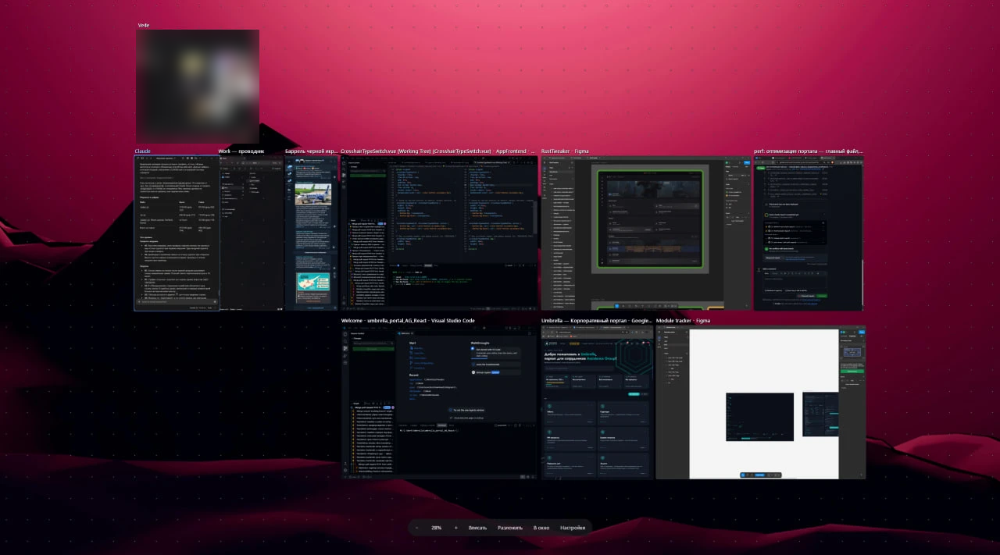

# InfiniDesk

Бесконечный рабочий стол для Windows. Все твои окна лежат на одном большом холсте: отдаляешь — видишь всё сразу, приближаешь — работаешь как обычно.

## Установка

Скачай `InfiniDesk.exe` из [Releases](../../releases/latest) и запусти. Установка не нужна, нужна Windows 10/11 x64.

Windows может ругнуться (файл без подписи): «Подробнее» → «Выполнить в любом случае».

## Как пользоваться

- **Alt + `** — открыть холст. Нажми ещё раз — влетишь в ближайшее окно.
- **Alt + колесо мыши** — масштаб, работает где угодно.
- **Alt + Tab** — камера летит к выбранному окну.
- **Тащи пустое место** — двигаешь холст.
- **Тащи окно за заголовок** — двигаешь окно, оно магнитится к соседям (Shift — без магнита).
- **Тащи край окна** — меняешь размер.
- Внизу панель: масштаб, «Вписать», «Разложить», «В окно», «Настройки».
- Иконка в трее: выход и настройки. В настройках — точки на фоне, магнит, автозапуск.

Хоткей можно поменять в `%APPDATA%\InfiniDesk\config.json`.
